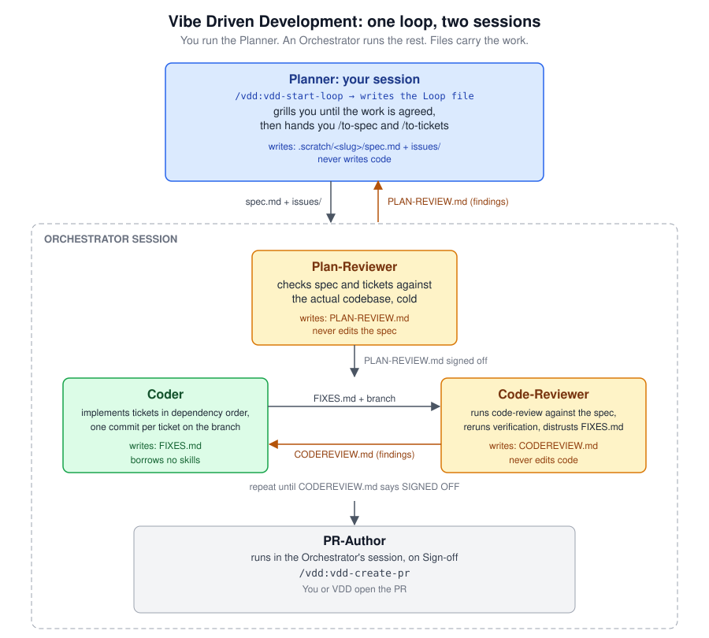
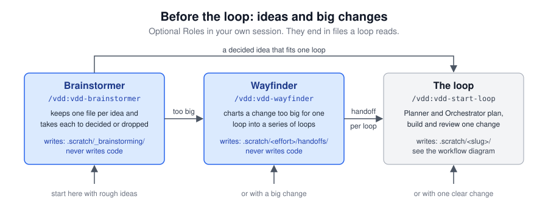

# Vibe Driven Development - Workflow and Skills

Install and requirements are in the [README](../README.md). You do not drive the loop by hand: `/vdd:vdd-start-loop` starts it, and each Role asks for what it needs when it needs it. This page explains what happens and why.

## 📚 Contents

- [🧩 Harnesses](#-harnesses)
- [🔁 The Vibe Driven Development Workflow](#-the-vibe-driven-development-workflow)
  - [📐 Phase 1: The Plan / Plan-Review loop](#-phase-1-the-plan--plan-review-loop)
  - [🔧 Phase 2: The Coder / Code-Review loop](#-phase-2-the-coder--code-review-loop)
  - [🚢 Phase 3: Ship](#-phase-3-ship)
- [🧭 Before the loop](#-before-the-loop)
  - [💡 The Brainstormer](#-the-brainstormer)
  - [🗺 The Wayfinder](#-the-wayfinder)
- [💡 Tips](#-tips)

## 🧩 Harnesses

The commands on this page are Claude Code's. On the other Harnesses:

| | Claude Code | Codex | Cursor | Copilot CLI |
|-|-------------|-------|--------|-------------|
| Skill | `/vdd:vdd-start-loop` | `$vdd:vdd-start-loop` | `/vdd-start-loop` | `/vdd:vdd-start-loop` |
| Open the Orchestrator | `claude` | `codex --no-daemon` | a new chat, or `agent` | `copilot` |
| Doorbell | rings by itself | rings by itself once you trust VDD's hook in `/hooks` | rings by itself | rings by itself |

If the other session does not wake, paste the line the Role prints.

## 🔁 The Vibe Driven Development Workflow

<div align="center">

<picture>
  <source media="(prefers-color-scheme: dark)" srcset="workflow-dark.svg">
  <source media="(prefers-color-scheme: light)" srcset="workflow-light.svg">
  
</picture>

</div>

A loop runs in three phases.

### 📐 Phase 1: The Plan / Plan-Review loop

#### 🤖 Model selection

The Planner and the Coder explore the codebase before they write, so token cost bears hardest on them. The reviewers read less and need judgement. Two ways to split it:

| Role | Vary the model | Vary the thinking level |
|------|----------------|-------------------------|
| 🧠 Planner, 💻 Coder | Claude Sonnet 5.5 | Claude Opus 5.5, Medium |
| 🔍 Plan-Reviewer, 🧪 Code-Reviewer | Claude Opus 5.5 | Claude Opus 5.5, High |

When the Planner's or the Coder's work is complex, buy judgement there too.

You pick the Planner's model when you open its session. The Orchestrator only spawns Roles, relays Doorbells and counts rounds, so a mid-tier model like Claude Sonnet 5.5 is enough for it. Before its first spawn it prints Model approval: a model per hosted Role, filled from what your environment says about models, such as the file below. You approve or correct the list once, and it holds for every spawn in the session.

An example, `~/.claude/AGENT_SELECTION.md`:

```markdown
# Agent Model Selection

Choose each subagent's model by the tier the task fits. When a task sits
between two tiers, take the higher one.

- haiku (claude-haiku-5-5): mechanical tasks with a clear answer, such as
  searching, reading files, counting and formatting.
- sonnet (claude-sonnet-5-5): scoped tasks whose goal and approach are
  settled, such as a clearly specified change, tests or docs. The vdd-coder
  on routine work.
- opus (claude-opus-5-5): tasks that need judgment, such as code and plan
  review, architecture and debugging an unclear cause. The vdd-plan-reviewer,
  the vdd-code-reviewer, and the vdd-coder on complex work.
```

Put it where your Harness reads its instructions; the path above is Claude Code's. User-level configuration lasts. Repository-level configuration costs a `.gitignore` entry or a change to a tracked file.

#### 🚀 Starting the loop

`/vdd:vdd-start-loop` runs the environment check, then asks for:

- a kebab-case slug for the work
- the base branch and the feature branch
- whether an open minor holds up Sign-off (`fix`, or `leave` it listed)
- whether VDD opens the PR at the end (yes, ask at Sign-off, or manual)
- how the Coder continues between rounds (fresh every round, resumed, or on Claude Code fresh once its context passes a limit)

The VDD tool writes the answers to the loop's Loop file, `.scratch/<slug>/loop.md`, which every Role reads first, so none asks again. If an earlier loop used the slug, you choose to continue it, start fresh (its directory is moved aside to `.scratch/<slug>-2/`, nothing deleted) or pick another slug. To check a repository before its first loop, run `/vdd:vdd-setup` on its own. It looks at the borrowed skills, the issue tracker and the gitignore entries, and tells you how to fix anything missing. It then prints a summary of the Loop file, which says you can ask the Orchestrator to start any Role fresh at its next round, and hands over to the Planner.

#### 🔔 Sessions and Doorbells

The session you started the loop in is the Planner. When the Planner rings its first Doorbell, open the Orchestrator in a second terminal in the repository with plain `claude` and `/vdd:vdd-orchestrator <slug>`, as the Planner prints it. It hosts the Plan-Reviewer, the Coder and the Code-Reviewer as subagents, each in a fresh context, and invokes the PR-Author at the end. You open no other session.

A Role that finishes its turn rings its counterpart instead of waiting for you. The Planner rings the Orchestrator, and the Orchestrator relays each Plan-Reviewer round back. A waiting session may ask, after 45 minutes, whether to keep waiting.

#### 🧠 The Planner

The Planner takes the problem you bring, or asks what it is when you bring none, and grills you until you agree what the work is. It then hands you `/to-spec` and `/to-tickets`, which publish `.scratch/<slug>/spec.md` and the tickets in `.scratch/<slug>/issues/`. It passes both through `writing-for-agents`, so the Coder gets documents written for the way it reads. The Planner never writes code.

#### 🔍 The Plan-Reviewer

The Plan-Reviewer checks that the spec and the tickets are complete and that every claim in them holds against the codebase. It checks their prose against `writing-for-agents`, because the Planner cannot grade its own. Its findings go to `PLAN-REVIEW.md`, and rounds pass through the Orchestrator until it signs off.

A blocker or a major always holds up Sign-off. On `Minors: fix` the loop runs until no minor is open; on `Minors: leave` the reviewer signs off with the open minors listed. One to three rounds is normal. More means the scope is too big: split the work.

### 🔧 Phase 2: The Coder / Code-Review loop

The Orchestrator starts this phase when `PLAN-REVIEW.md` signs off. You open nothing.

#### 💻 The Coder

The Coder works on the feature branch from the Loop file, which defaults to the slug. It takes the tickets in dependency order: implements one, runs its acceptance criteria, commits it, and writes what it did to `FIXES.md`. If it is on neither the base nor the feature branch, or holds a Ticket it finds wrong or impossible, it asks; the Orchestrator relays the question to you and your answer back.

#### 🧪 The Code-Reviewer

The Code-Reviewer runs Matt Pocock's `code-review` over the branch against the spec, then adds what that skill does not do: it reruns the verification itself, distrusts `FIXES.md` and the ticked checkboxes, and flags anything in the diff no ticket asked for. When the branch changes a skill file, an `AGENTS.md`, a `CLAUDE.md` or a file one of those points at, it checks those lines against `writing-for-agents`. Its findings go to `CODEREVIEW.md`, and rounds run until Sign-off under the same rule as Phase 1.

### 🚢 Phase 3: Ship

On Sign-off the Orchestrator runs the PR-Author in its own session, which follows the Loop file's `PR:` line:

- `PR: yes` shows you the body, pushes the branch and opens the PR.
- `PR: ask at sign-off` asks you then.
- `PR: manual` prints the body and touches neither the branch nor the remote.
- `PR: no` skips the PR-Author. The branch stays local and no body is printed.

Then:

1. If the PR is not open, open it from the feature branch with the printed body. The commits are there, one per ticket plus any no ticket owned. The working files are gitignored and stay behind.
2. The loop is closed by then, and `.scratch/<slug>/` keeps the Loop file, the spec, the tickets and the three review files as its record. It is gitignored, so it stays on this machine. To fix something before you merge, a finding from an outside review for example, ask the Orchestrator to reopen the loop.
3. Start the next loop with fresh sessions.

## 🧭 Before the loop

<div align="center">

<picture>
  <source media="(prefers-color-scheme: dark)" srcset="before-the-loop-dark.svg">
  <source media="(prefers-color-scheme: light)" srcset="before-the-loop-light.svg">
  
</picture>

</div>

Two optional Roles run in your own session before a loop. Neither starts the next Role: you carry what they write forward yourself.

### 💡 The Brainstormer

`/vdd:vdd-brainstormer` keeps ideas in `.scratch/_brainstorming/`: one file per idea, an `index.md` listing each with its status, and `research/` for test results worth keeping. Each idea is rated for importance, size and fog, the unknowns between you and knowing whether it works. Ask for an overview and it suggests what to work on next.

It talks an idea through, clears fog with the cheapest test that answers the question, and grills you with Matt Pocock's `grilling` once you can decide. An idea ends `decided` or `dropped`, with the date and the reason. A dropped idea records when it is worth reopening, so it is not argued twice. Give a decided idea to `/vdd:vdd-start-loop` as the problem statement, or to the Wayfinder if it is too big for one loop.

### 🗺 The Wayfinder

`/vdd:vdd-wayfinder` is for a change too big for one loop, or one whose goal is unclear. It asks for the effort's name and what it is, prints a briefing on VDD, and hands you to Matt Pocock's `wayfinder`, which charts the effort in `.scratch/<effort>/map.md` over as many sessions as it needs.

The map is done when `.scratch/<effort>/handoffs/` holds `00-overview.md` and one `NN-<slug>.md` per loop. The overview names the destination, the loops in order, the gate each loop must pass, and the rules every loop inherits. It ends with a prompt per loop: run `/vdd:vdd-start-loop`, fill in the loop number and the handoff, and paste the prompt as the problem statement. That loop's Planner reads the overview and its handoff and grills you on that loop alone.

## 💡 Tips

- **After resuming a waiting Planner, tell it so.** A resumed session holds no wait, and your word is what tells the Planner to arm it again; otherwise you paste the next relay by hand.
- **Keep loops small.** One bug or one refactoring per loop. A loop that does not converge in a few rounds should be split.
- **Mix vendors if you can.** A reviewer from a different model family catches blind spots two sessions of one model share.
